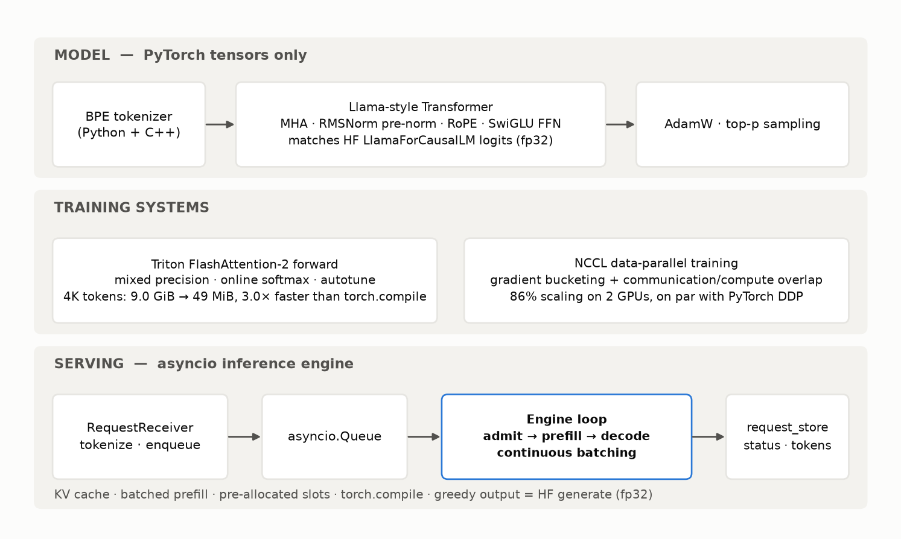
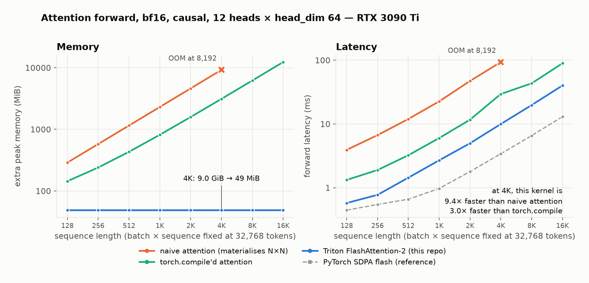
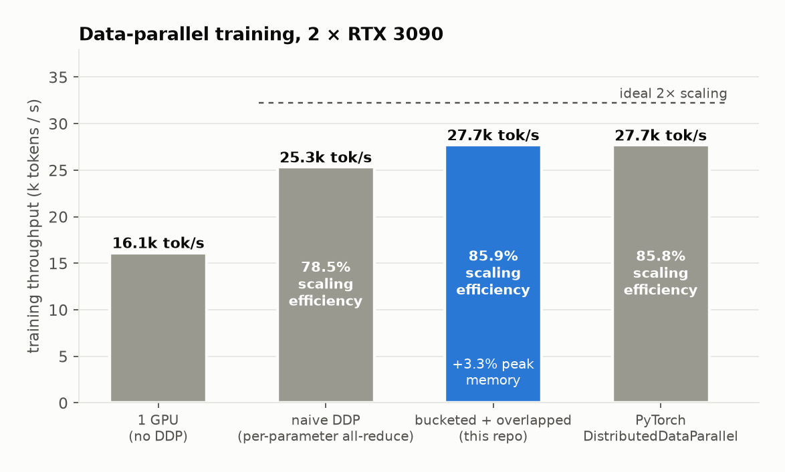
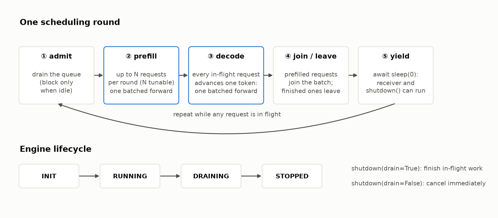
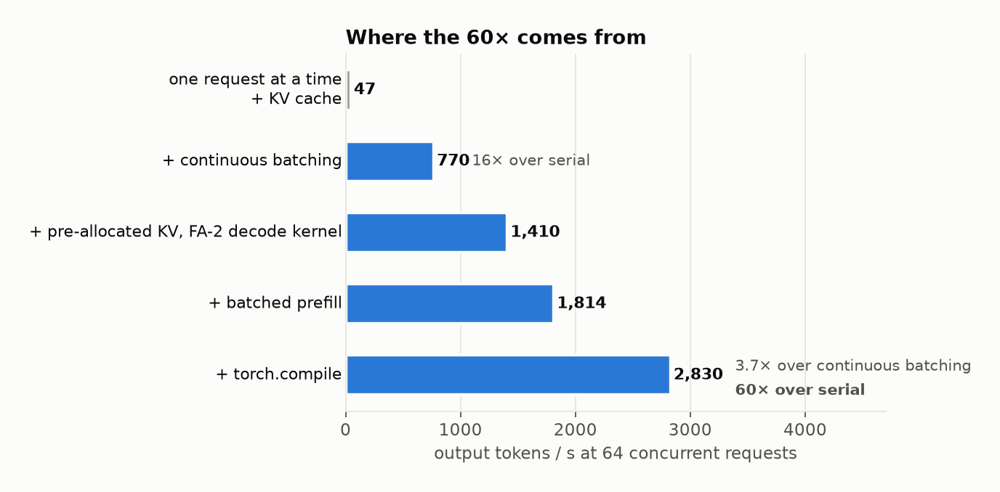
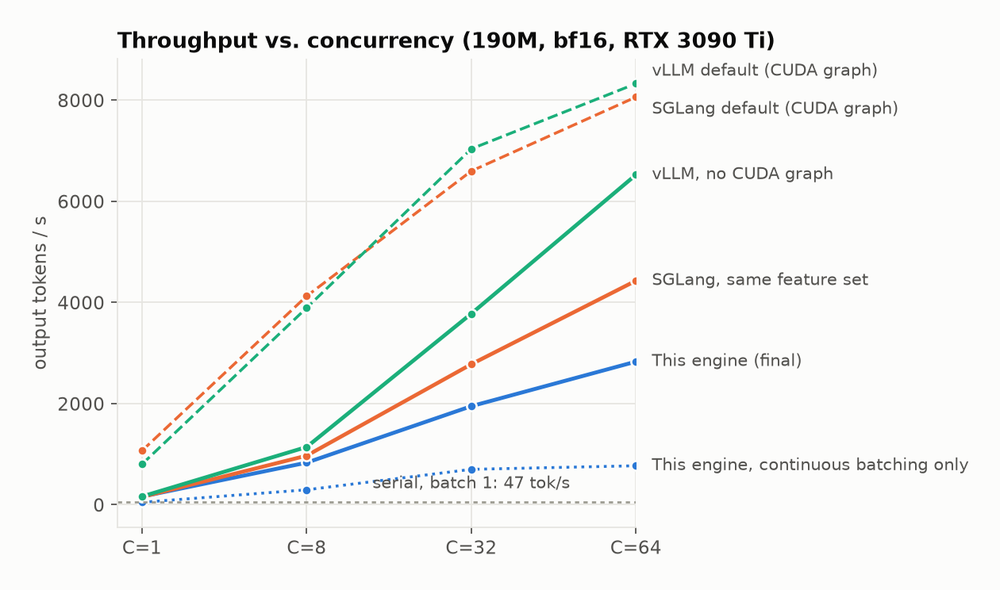
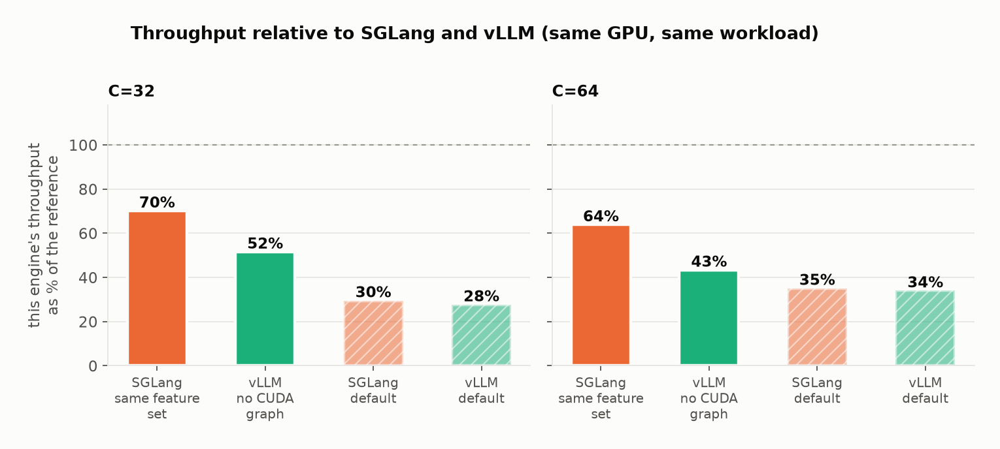
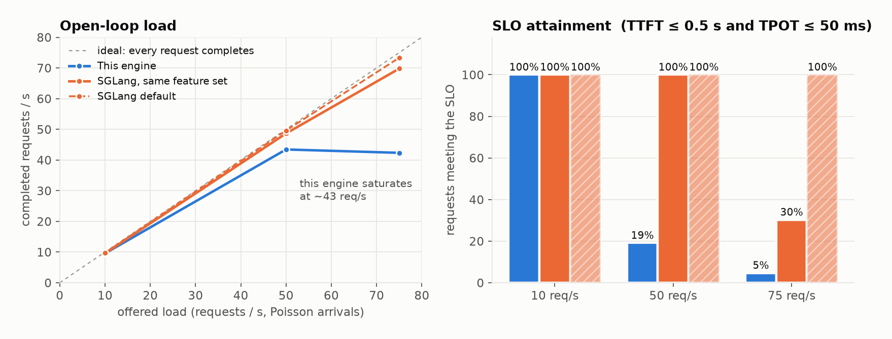

# llm-stack

A Llama training and inference stack built from PyTorch tensors, without existing frameworks: BPE tokenizer, Transformer, a Triton FlashAttention-2 kernel,
NCCL data-parallel training with gradient bucketing, and an asyncio inference engine with continuous batching — benchmarked against HuggingFace, PyTorch DDP,
SGLang and vLLM on the same GPU.

| | Result | Reference |
|---|---|---|
| Model | fp32 logits within **2.2e-5 – 3.2e-5** of HF `LlamaForCausalLM` (190M weights, seq 48 – 1024), argmax 100% equal | [Model](#model) |
| Attention kernel | 4K tokens: **9.0 GiB → 49 MiB** peak memory, **9.4×** faster than naive attention, **3.0×** faster than `torch.compile`d attention | [Attention](#attention-kernel) |
| Distributed training | 2 GPUs: **86%** scaling efficiency, **27.7k tok/s** — equal to PyTorch DDP (27.7k tok/s) | [DDP](#distributed-training) |
| Serving, 64 concurrent requests | **47 → 2,830 tok/s (60×)**: continuous batching 16×, then 3.7× from the remaining optimisations | [Serving](#serving-engine) |
| Serving vs. SGLang / vLLM | 32 requests: **70%** of SGLang and **52%** of vLLM at the same feature set (no CUDA graph); 64 requests: 64% / 43% | [Comparison](#comparison-with-sglang-and-vllm) |

**Hardware** — 1× NVIDIA RTX 3090 Ti (24 GB, 450 W, driver 580) rented on Vast.ai; training runs use 2× RTX 3090 ·
**Serving model** — 190M Llama-style Transformer, bf16, random weights (speed only) · **Load** — closed loop at concurrency C, 32–96 output tokens, 3 repetitions ·
**Data** — [`results/final/`](benchmarks/compare/results/final/), every row carries versions and GPU.

```bash
# CUDA box, after benchmarks/compare/remote/setup_gpu_box.sh (see benchmarks/compare/RUNBOOK.md); ~1.5 h
bash benchmarks/compare/remote/run_stage_d.sh all     # engine ladder -> SGLang -> vLLM -> open loop -> correctness   (run `... smoke` first)
```



Output tokens / s, higher is better:

| System | C=1 | C=8 | C=32 | C=64 | C=64 ÷ serial |
|---|---:|---:|---:|---:|---:|
| This engine — one request at a time, KV cache | 47 | — | 47 | — | 1× |
| This engine — continuous batching | 47 | 295 | 699 | 770 | 16× |
| This engine — final (+ pre-allocated KV, FA-2 decode, batched prefill, `torch.compile`) | 161 | 832 | 1,948 | **2,830** | **60×** |
| SGLang 0.5.10 — continuous batching only (no CUDA graph / radix cache / chunked prefill) | 153 | 969 | 2,778 | 4,429 | 94× |
| vLLM 0.31 — no CUDA graph, no prefix cache (`torch.compile` on) | 162 | 1,141 | 3,778 | 6,525 | 139× |
| SGLang — default config (CUDA graph) | 1,068 | 4,125 | 6,599 | 8,061 | 172× |
| vLLM — default config (CUDA graph) | 800 | 3,892 | 7,037 | 8,327 | 177× |

---

## Model

PyTorch tensors only: BPE tokenizer (Python and C++), multi-head attention, RMSNorm (pre-norm), RoPE, SwiGLU feed-forward, AdamW, top-p sampling.

Equivalence with HuggingFace's reference implementation is checked on the trained 190M model: the weights are converted to `LlamaForCausalLM`
([`convert_190m_to_hf.py`](benchmarks/compare/convert_hf/convert_190m_to_hf.py): RoPE pairing permutation, untied head) and fp32 logits are compared —
max |Δlogit| **2.2e-5** at sequence length 48, 2.5e-5 at 256, 3.2e-5 at 1,024 (logit scale ≈ 2.4), argmax agreement 100%. Two mutation checks (skip the q/k permutation; swap gate/up) must fail, otherwise the test could not tell right from wrong.

190M model trained on FineWeb-Edu (45,000 steps): HellaSwag acc_norm 0.284, ARC-Easy acc 0.482; held-out perplexity 27.5 (FineWeb-Edu), 44.3 (C4), 42.1 (Wikipedia) — [`training/artifacts/190m/`](training/artifacts/190m/).

## Attention kernel

`flash_attention_triton.py`: FlashAttention-2 forward in Triton — tiled online softmax, mixed precision (bf16 inputs, fp32 accumulation), autotuned. The N×N score matrix is never materialised.
Time was attributed with Nsight Systems and `torch.profiler` ([`profile_prefill.py`](benchmarks/compare/attention/profile_prefill.py)).



| Sequence (batch × sequence = 32,768) | naive attention | `torch.compile`d | **Triton FA-2** | flash-attn 2.8.3 | PyTorch SDPA flash |
|---:|---:|---:|---:|---:|---:|
| 1,024 | 22.6 ms | 6.01 ms | **2.69 ms** | 1.21 ms | 0.97 ms |
| 4,096 | 93.3 ms · 9.0 GiB | 29.5 ms · 3.0 GiB | **9.96 ms · 49 MiB** | 3.79 ms · 50 MiB | 3.40 ms · 50 MiB |
| 8,192 | OOM | 43.3 ms | **19.8 ms** | 7.37 ms | 6.56 ms |
| 16,384 | OOM | 89.2 ms | **40.0 ms** | 14.7 ms | 13.0 ms |

- At 4K: 9.4× faster than naive attention (93.3 / 9.96) and 3.0× faster than `torch.compile`d attention (29.5 / 9.96); memory stays at ≈49 MiB at every length.
- It is 2.8–3.1× slower than PyTorch's SDPA flash kernel (20 vs 63 TFLOP/s). Measured breakdown: causal upper-triangle tiles are not skipped (≈1.67×) and each tile runs less efficiently (≈1.77×).
- Only the forward pass is a Triton kernel; the backward is a PyTorch recompute that materialises N×N. The earlier "6.54× at 8K" figure is withdrawn: its baseline does not fit in memory at 8K in a fresh process.
- Training, 190M model, context 2,560, batch 1, one RTX 3090, forward + backward: 12.3 s vs 19.9 s per 32-sample epoch against naive attention (1.62×), peak 7.8 GB vs 17.4 GB.

## Distributed training

`FlashDDP.py` (`DDPOverlapBucketed`): gradients are grouped into size-bounded buckets, each a view into one contiguous buffer; a bucket's NCCL all-reduce is launched on a separate
CUDA stream as soon as its last gradient is produced, so communication overlaps the rest of the backward pass.



| Strategy | GPUs | tok/s | Scaling efficiency | Peak memory overhead |
|---|---:|---:|---:|---:|
| Local, no DDP | 1 | 16,132.4 | — | — |
| Naive DDP (per-parameter all-reduce) | 2 | 25,336.7 | 78.5% | −3.3 MB |
| **Bucketed + overlapped** | 2 | **27,719.1** | **85.9%** | +498.8 MB (+3.3%) |
| PyTorch `DistributedDataParallel` | 2 | 27,692.6 | 85.8% | +489.5 MB (+3.2%) |

+9.4% over naive DDP; 0.1% from PyTorch's implementation (within run-to-run noise). Small configuration (12 layers, 10k vocab, context 512), n = 1 per row; the original CSV was lost with the rented machine, so the table is transcribed from
[`lm_matrix_table_flash_attention_triton.png`](training/artifacts/lm_matrix_table_flash_attention_triton.png). On the 190M model (context 1,024, batch 8 per GPU, 12 timed epochs): 82.3% for bucketed DDP vs 77.1% for naive DDP, no PyTorch-DDP row.
Scaling efficiency is `tps₂ / (2·tps₁)` at equal per-GPU batch.

## Serving engine

`serving/inferenceLM/`: asyncio inference engine. The request receiver tokenizes and enqueues; the engine consumes from a shared `asyncio.Queue` and runs requests concurrently, one scheduling round at a time.



- **Configurable scheduling** — each round prefills at most N newly admitted requests (`max_prefills_per_round`), trading decode stalls against batch size; with batched prefill the round is one prefill forward followed by one decode step.
- **Two shutdown modes** — `shutdown(drain=True)` lets in-flight work finish, `shutdown(drain=False)` cancels it; a plain "stop" flag could never wake a consumer parked on `await queue.get()`, so the drain sentinel and the cancel are the two ways out.
- **Correctness** — greedy output equals HF `generate` token for token in fp32 (32/32 prompts on GPU, 16/16 on CPU with the real 190M weights); concurrent output equals sequential greedy decoding; tests pin the alternation order, failure isolation and shutdown behaviour.
- **KV cache** — `forward_with_cache()` is an inference-only path beside the untouched training `forward()`. Decode must pass `is_causal=False` (the causal mask is built as `tril(seq_q, seq_k)`, which for one query row would expose only key 0) and RoPE must be applied at absolute positions *before* keys enter the cache; [`kv_cache_gate.py`](training/cs336_systems/experiments/kv_cache_gate.py) requires cached decode to be token-identical to full recompute.

**Not built yet:** admission control (more requests in flight than KV slots stops the loop; the open-loop benchmark caps in-flight requests itself), a block-based (paged) KV cache, ragged attention without padding, CUDA-graph decode, sampling other than greedy in the batched path.

### Continuous batching



Concurrent requests share one batched forward per step: a left-padded KV rectangle with per-row RoPE positions and a key-validity mask lets rows of different lengths decode together; finished requests leave and new ones join between steps.
On top of that: batched right-padded prefill (one forward for several prompts, only the last position's logits are computed), pre-allocated KV slots appended in place, flash-attn's KV-cache decode kernel, and the decode step compiled as one `torch.compile` graph.

At 64 concurrent requests: **47 → 770 tok/s (16×)** from continuous batching alone, **770 → 2,830 tok/s (3.7×)** from the rest, **60×** in total.
Output of the final configuration against HF `generate` (bf16, real weights, 64 prompts × 64 tokens): 49/64 identical token for token, teacher-forced argmax agreement 99.5% — bf16 rounding makes near-ties diverge (the unoptimised path scores 20/32 on a 32-prompt check).

### Comparison with SGLang and vLLM





At the same feature set (no CUDA graph, no radix / prefix cache, no chunked prefill for SGLang), the engine reaches **70% of SGLang and 52% of vLLM at 32 concurrent requests**, 64% and 43% at 64. SGLang's and vLLM's default configurations additionally use CUDA graphs, which this engine does not (2.9–6.6× faster).
At C=64 p50 TTFT is 33 ms vs 17 ms (SGLang) and p50 TPOT 22 ms vs 14 ms; the full latency columns (TTFT / TPOT / ITL p99, goodput) are in [`serving_stage_d.csv`](benchmarks/compare/results/final/serving_stage_d.csv).

### Open-loop load and service-level objectives



Poisson arrivals, 30 s × 3 repetitions, in-flight cap 64, same arrival schedule for every system. The engine completes **43.4 requests/s** when 50 are offered (SGLang, same feature set: 48.7 — 89%) and saturates there: at 75 offered it still completes 42.3 against SGLang's 69.8.
With the service-level objective TTFT ≤ 0.5 s **and** TPOT ≤ 50 ms, **19%** of the engine's requests attain it at 50 req/s (SGLang: 100%). Decode speed is not the problem (p50 TPOT 22 ms); the TTFT p50 is 2.1 s, i.e. requests queue — admission and scheduling policy is the next thing to improve.

---

## Other measurements

### KV cache vs. recompute

Per-token decode latency, one request (random weights, 8 new tokens, [`serving_kv_sweep.csv`](benchmarks/compare/results/final/serving_kv_sweep.csv)):

| Model | Context | Recompute (ms/token) | KV cache (ms/token) | Speed-up | End-to-end speed-up |
|---|---:|---:|---:|---:|---:|
| 190M | 8,192 | 113.4 | 21.2 | 5.3× | 3.7× |
| 1.4B | 8,192 | 628.9 | 42.3 | 14.9× | 5.9× |
| 6.9B | 8,192 | 2,460.5 | 89.6 | 27.5× | 7.2× |

The benefit grows with model size and context; end-to-end is smaller because prefill is identical for both. At short context a 190M model is launch-bound and the cache buys ~1.2×. The single-request cache path appends with `torch.cat`, so its peak memory is about 2× the KV size (6.9B at 12,288 context does not fit); the pre-allocated path used by the batched engine does not have this problem.

### C++ BPE tokenizer

Pretokenisation only (290 MB OpenWebText, Apple M4 Pro): Python 44.3 s serial / 13.6 s on 4 processes; C++ 16.6 s serial / **8.95 s on 4 threads** — 1.5× over the 4-process Python version, 1.86× over its own serial run.
The BPE merge phase is serial in both and is the end-to-end bottleneck; on text containing newlines the two implementations do not produce identical merges (the C++ reader drops `\n` before splitting).

---

## Roadmap

| | Status |
|---|---|
| Engine lifecycle state machine + graceful drain | ✅ |
| Request / iteration lifecycle split, ragged batched decode (continuous batching) — #11, #17 | ✅ |
| Optimised decode path: pre-allocated KV, FA-2, batched prefill, `torch.compile` — #24 | ✅ |
| Cross-system benchmark harness and results — #25 | ✅ |
| Admission control (reject / queue beyond KV capacity) | ⬜ |
| Block-based (paged) KV cache — block table + free list — #12 | ⬜ planned |
| Ragged attention forward — no padding, gather by block table — #13 | ⬜ planned |
| CUDA-graph decode (the 2.9–6.6× gap to the default SGLang / vLLM configurations) | ⬜ |

## Reproduce

```bash
uv sync
source .venv/bin/activate
```

```bash
# CPU only: the serving test-suite and the benchmark-harness tests
(cd serving && uv run pytest tests -q)                                  # LMS_M2=1 also runs the 19 batched-decode acceptance tests
(cd benchmarks/compare && ../../.venv/bin/python -m pytest -q)
python benchmarks/compare/figures/make_figures.py                       # redraws every figure above from results/final/*.csv
```

```bash
# GPU, prepared box: one phase of the serving benchmark, or all of them; the attention sweep (single GPU)
bash benchmarks/compare/remote/run_stage_d.sh ladder
bash benchmarks/compare/remote/run_stage_d.sh all
bash benchmarks/compare/remote/run_stage_a.sh
```

```bash
# Training kernel x DDP-strategy matrix (needs 2 CUDA GPUs + Triton)
uv run python training/cs336_systems/experiments/benchmark_lm_matrix.py \
  --config training/cs336_systems/experiments/default_pipeline_config.json \
  --train_path data/tokenized/ts_train.npy --val_path data/tokenized/ts_valid.npy \
  --timed_epochs 3 --kernels flash_attention_triton \
  --wrappers "Local No DDP" "Naive DDP" "Pytorch DDP" "Bucketed Overlapping DDP"
```

Caveats that move the serving numbers by ±15–20%: the three stacks run different torch versions (2.6 / 2.9 / 2.13); the engine is timed in-process while SGLang and vLLM are measured over HTTP; 128 distinct prompts are looped; random weights.
The `git_sha` column in `results/final` is the baseline commit — the code was synced to the rented machine as a working tree. Full list of limitations: [`benchmarks/compare/README.md`](benchmarks/compare/README.md).

## Navigating this repo

[`START_HERE.md`](START_HERE.md) is the module index — which file holds what, and **which documents are current versus superseded**. Training extends the Stanford CS336 assignment scaffolding; original handouts are under [`training/`](training/).
