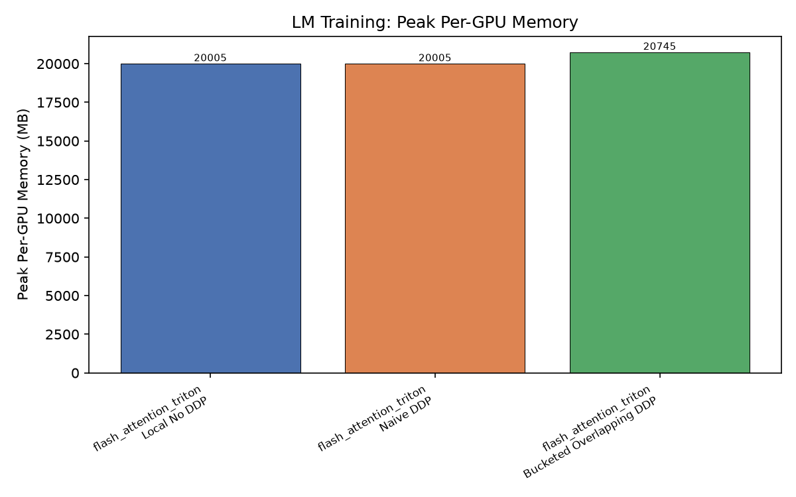
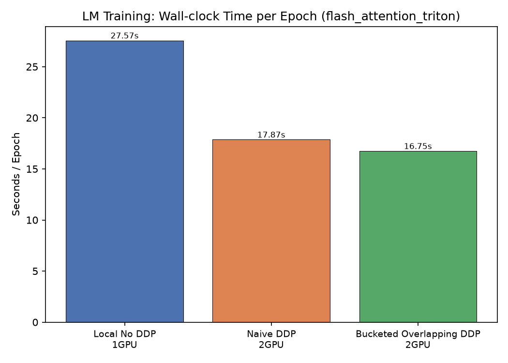
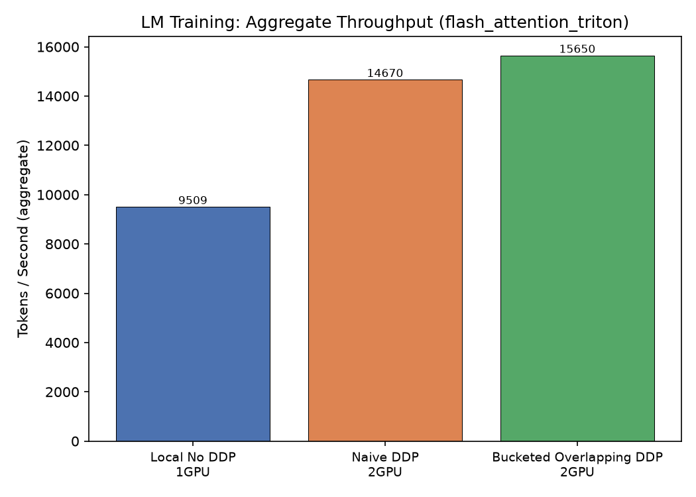
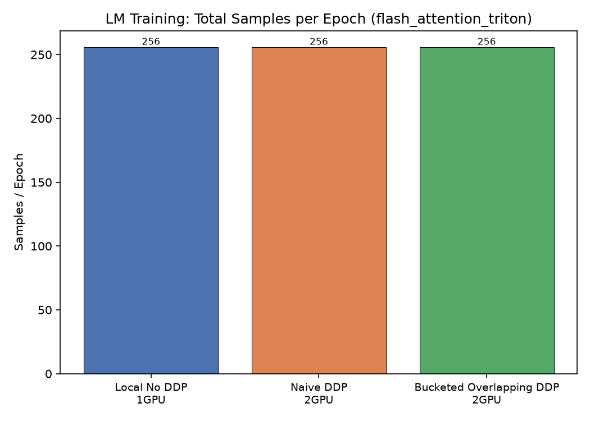
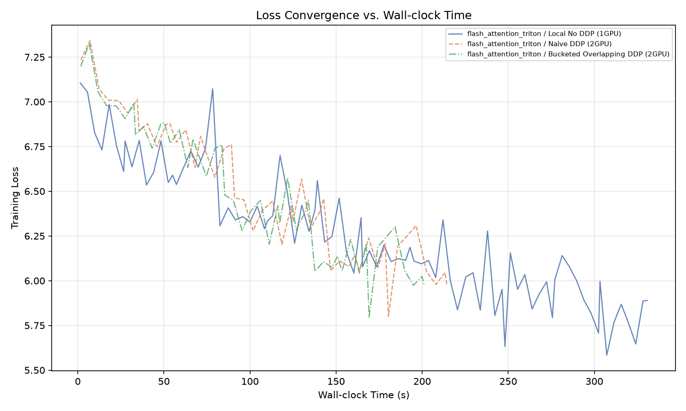

# LM Training Benchmark Matrix

## Design

- **Local batch size** is the **same** across single-GPU and DDP.
- **Steps per epoch** is identical for all configurations.
- DDP therefore processes `world_size ×` more samples per epoch in roughly the same wall-clock time.
- Memory is reported **per-GPU** (worst-case across ranks).

## Results

| Kernel | DDP | GPUs | Epochs | Steps/ep | Global BS | Local BS | Samples/ep | Wall (s) | s/ep | tok/s | Peak GPU MB |
|--------|-----|------|--------|----------|-----------|----------|------------|----------|------|-------|-------------|
| flash_attention_triton | Local No DDP | 1 | 12 | 32 | 8 | 8 | 256 | 330.808 | 27.567 | 9509.2 | 20004.7 |
| flash_attention_triton | Naive DDP | 2 | 12 | 16 | 16 | 8 | 256 | 214.43 | 17.869 | 14670.2 | 20004.7 |
| flash_attention_triton | Bucketed Overlapping DDP | 2 | 12 | 16 | 16 | 8 | 256 | 201.001 | 16.75 | 15650.3 | 20745.0 |

## Charts

### flash_attention_triton

