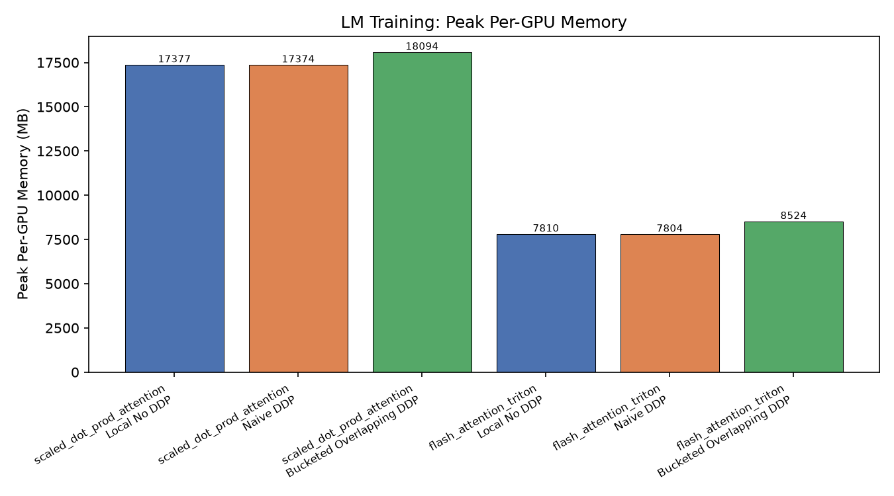
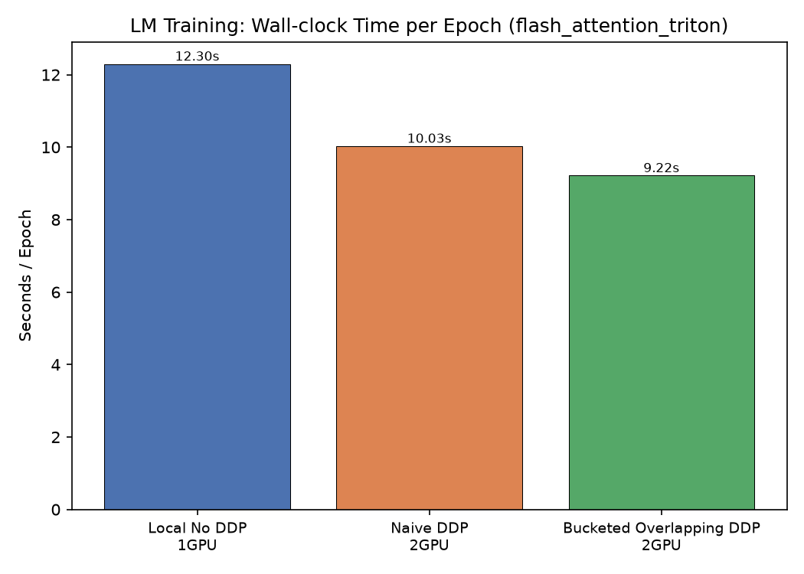
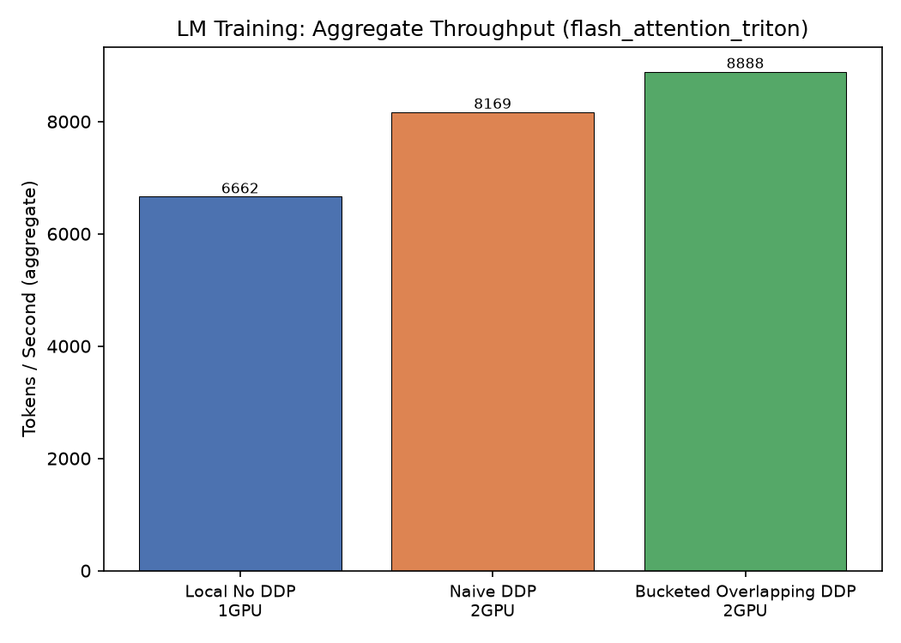
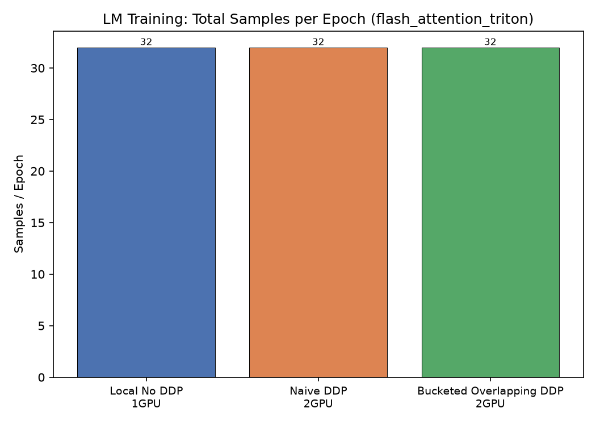
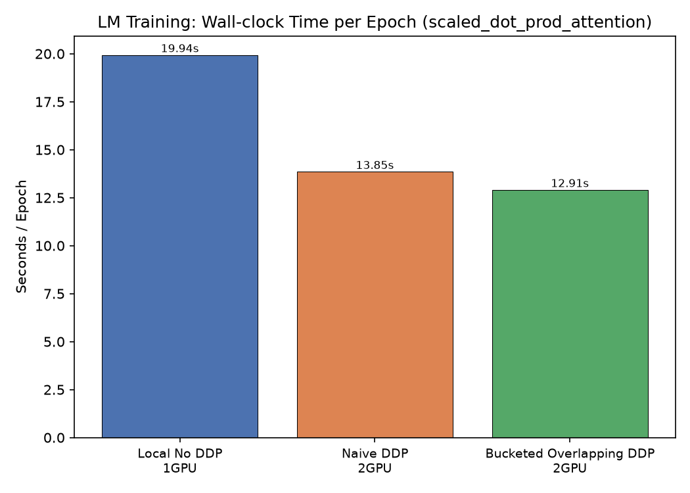
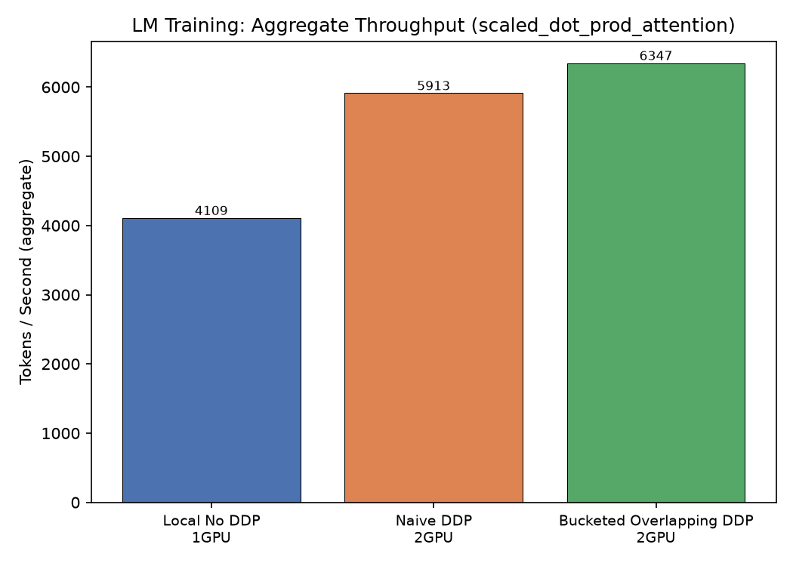
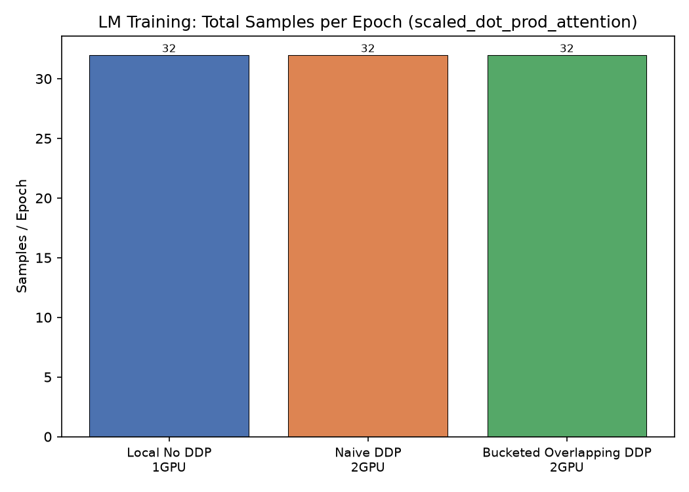
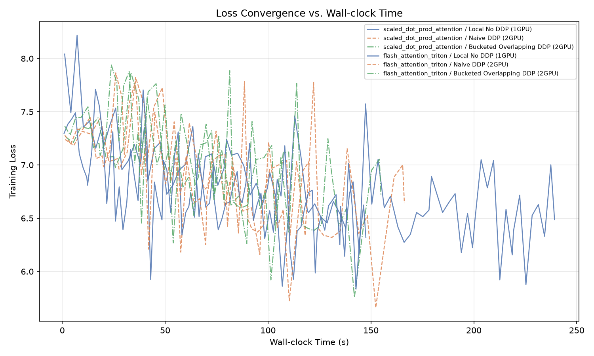

# LM Training Benchmark Matrix

## Design

- **Local batch size** is the **same** across single-GPU and DDP.
- **Steps per epoch** is identical for all configurations.
- DDP therefore processes `world_size ×` more samples per epoch in roughly the same wall-clock time.
- Memory is reported **per-GPU** (worst-case across ranks).

## Results

| Kernel | DDP | GPUs | Epochs | Steps/ep | Global BS | Local BS | Samples/ep | Wall (s) | s/ep | tok/s | Peak GPU MB |
|--------|-----|------|--------|----------|-----------|----------|------------|----------|------|-------|-------------|
| scaled_dot_prod_attention | Local No DDP | 1 | 12 | 32 | 1 | 1 | 32 | 239.237 | 19.936 | 4109.1 | 17377.2 |
| scaled_dot_prod_attention | Naive DDP | 2 | 12 | 16 | 2 | 1 | 32 | 166.254 | 13.854 | 5912.9 | 17373.5 |
| scaled_dot_prod_attention | Bucketed Overlapping DDP | 2 | 12 | 16 | 2 | 1 | 32 | 154.891 | 12.908 | 6346.6 | 18093.7 |
| flash_attention_triton | Local No DDP | 1 | 12 | 32 | 1 | 1 | 32 | 147.549 | 12.296 | 6662.5 | 7810.3 |
| flash_attention_triton | Naive DDP | 2 | 12 | 16 | 2 | 1 | 32 | 120.339 | 10.028 | 8168.9 | 7803.6 |
| flash_attention_triton | Bucketed Overlapping DDP | 2 | 12 | 16 | 2 | 1 | 32 | 110.598 | 9.216 | 8888.4 | 8523.8 |

## Charts

### flash_attention_triton

### scaled_dot_prod_attention

